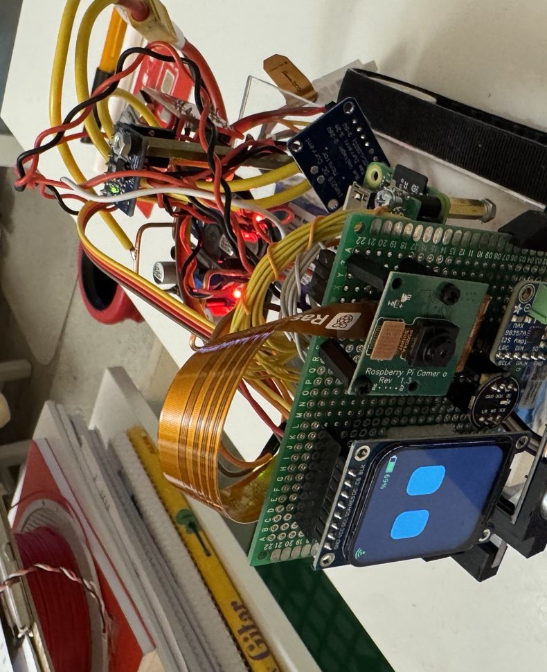

# NeuroVision Online

Raspberry Pi Zero 2 W üzerinde çalışan, Gemini Live ile konuşan ve hareketlerini AI'ın yönettiği paletli ev robotu.
Sesle konuşur, kamerayla görür, mesafe ölçer, açılı döner, kişiyi bulup yanına gelir, takip eder ve kendi bataryasını bilir.

Bu sürüm stabil kayıttır: `bp-2026-10-30-robot-dinliyor` ve sonrası.



## Özellikler

### Konuşma
- Gemini Live ile canlı Türkçe sohbet (`gemini-3.8-live`, `tr-TR`).
- Yerel konuşma kapısı: sessizlikte internete ses gitmez.
- Hafıza: sohbet dökümü, özetler ve kalıcı bilgiler Pi'de SQLite içinde (`data/memory.db`).
- Hava durumu (Open-Meteo) ve Vikipedi araması; ses düzeyi ve motor hızı sesle değiştirilir.
- Sesle kapanma; ilk kurulum için Wi-Fi portalı.

### Hareket
- Açılı dönüş: MPU6050 jiroskopu ile. Sapma yerde 1.7° altında, 90° yaklaşık 1 sn.
- Düz gidiş: jiroskop yönü korur, 2 sn'de sapma yaklaşık 1°.
- Hız: normal yaklaşık 24 cm/sn; yavaş yaklaşık 18, hızlı yaklaşık 30 cm/sn.
- Tek hareket en fazla 15 sn; konuşmadan 15 sn, 60 sn'de 45 sn sınırı var.

### Görme ve davranış
- Yerel nesne tanıma: YOLO11n 320 (COCO 80 nesne), kare başına yaklaşık 0.4 sn. Renk bölgesi tanıma.
- **Bana gel:** AI kişiyi bulur, `turn_to` ile döner, tekrar kontrol eder, sonarla ölçer, süreyi hesaplayıp yürür.
- **Beni bulup takip et:** AI görmezse dönerek arar. Takip sonarla 60 cm hedefler, kaybedince son gördüğü tarafa arar.
- Robot görüntüdeki nesneleri tanımlar, sorulan nesneye döner.

### Beden farkındalığı
- Çarpma, eğim, kaldırılma ve motor zorlanması olayları AI'a gider, ne yapacağına AI karar verir.
- `body_status`: batarya, akım, güç, denge, mesafe, sıcaklık, CPU, RAM, disk, Wi-Fi, GPIO, I²C, Gemini kullanımı.

### Batarya
- INA219 ile voltaj, akım ve güç. Oran harcanan akımdan hesaplanır, Pi kapansa da korunur.
- Gözler orana göre renk değiştirir: mavi, sarı (%35 altı), turuncu (%20 altı), kırmızı (%10 altı).
- Seviye düşünce AI bilgilendirilir. Kalan süreyi AI kendisi hesaplar, kapasiteyi sorup kaydedebilir.
- Voltaj 30 sn 10.5 V altında kalırsa robot durur, veda eder ve Pi temiz kapanır.

### Güvenlik refleksleri
Bunlar AI'dan bağımsız, robotun üstünde çalışır:
- İleri giderken 25 cm'de engelde anında durur, engel varken ileri gitmez.
- Çarpma, eğim veya kaldırılmada hareketi keser.
- Motor çalışırken konuşursan durur. 120–900 Hz bandına bakar: konuşma motor üstünde 15–22 dB yükselir.
- Bağlantı koptuğunda motorlar durur.

### Ekran
- Gözler, ifadeler ve altyazı.
- Sol üst Wi-Fi: yeşil Gemini bağlı, sarı Wi-Fi var Gemini yok, kırmızı çarpı Wi-Fi yok.
- Sağ üst batarya yüzdesi ve pil simgesi.

## Malzeme listesi

| Parça | Adet | Görev |
|---|---|---|
| Raspberry Pi Zero 2 W | 1 | Ana bilgisayar |
| Raspberry Pi Camera v1.3 (OV5647) | 1 | Görüntü, CSI kablosuyla |
| 3S 2600 mAh LiPo batarya | 1 | Ana güç (11.1 V nominal, 12.6 V dolu) |
| LM2596 step-down modülü | 2 | Biri Pi için 5.0 V, biri motorlar için 6.0 V |
| MX1508 çift H-köprü motor sürücü | 1 | Palet motorları |
| 6 V 300 RPM redüktörlü DC motor | 2 | Sol ve sağ palet |
| Pololu 30T palet seti | 1 | Yürüyüş takımı |
| MPU6050 IMU | 1 | Jiroskop ve ivmeölçer, I²C `0x68` |
| INA219 akım/voltaj sensörü (R100 şönt) | 1 | Batarya ölçümü, I²C `0x40` |
| HC-SR04 ultrasonik sensör | 1 | Mesafe; ECHO 3.3 V'a uyarlı |
| 1.69" ST7789 240×280 SPI ekran | 1 | Robotun yüzü |
| INMP441 I²S MEMS mikrofon | 1 | Ses girişi |
| MAX98357A I²S 3 W amplifikatör | 1 | Ses çıkışı |
| 8 Ω 2 W mini hoparlör | 1 | Hoparlör |
| 3D baskı şasi | 1 | Alt gövde |
| Pleksiglas üst şasi | 1 | Üst plaka |
| 1 kΩ ve 2 kΩ direnç | 1'er | HC-SR04 ECHO voltaj bölücü |
| Delikli pertinaks, kablo, konnektör | - | Montaj |

Şasinin 3D baskı dosyaları bu depoda yok.

## Güç bağlantısı

```text
3S LiPo (+) ──► INA219 VIN+  INA219 VIN- ─┬─► LM2596 #1 ──► 5.0 V ──► Pi Zero 2 W, MAX98357A, HC-SR04
                                          └─► LM2596 #2 ──► 6.0 V ──► MX1508 motor gücü
3S LiPo (-) ──────────────────────────────► iki LM2596 GND ──► ortak GND (Pi dahil)
```

- LM2596 çıkışlarını motorları ve Pi'yi bağlamadan önce multimetreyle ayarla: **Pi 5.0 V, motor 6.0 V**.
- Tüm GND'ler ortak olmalı. INA219 voltajı `VIN-` ile GND arasından ölçer.
- INA219 modülünü R100 şöntle ölçüm aralığı yaklaşık 3.2 A'dır.

## Pin yapısı

BCM GPIO numaraları. Fiziksel pin parantez içinde.

| Modül | Modül pini | Pi |
|---|---|---|
| MPU6050 | VCC / GND | 3.3 V / GND |
| | SDA / SCL | GPIO2 (3) / GPIO3 (5) |
| INA219 | VCC / GND | 3.3 V / GND |
| | SDA / SCL | GPIO2 (3) / GPIO3 (5) |
| HC-SR04 | VCC / GND | 5 V / GND |
| | TRIG | GPIO4 (7) |
| | ECHO | GPIO17 (11), 1k/2k bölücüyle |
| ST7789 ekran | VCC / GND | 3.3 V / GND |
| | SCL / SDA | GPIO11 (23) / GPIO10 (19) |
| | RES / DC | GPIO5 (29) / GPIO25 (22) |
| | CS / BLK | GPIO8 (24) / GPIO6 (31) |
| INMP441 | VDD / GND | 3.3 V / GND |
| | SCK / WS | GPIO18 (12) / GPIO19 (35) |
| | SD | GPIO20 (38) |
| | L/R | GND |
| MAX98357A | VIN / GND | 5 V / GND |
| | BCLK / LRC | GPIO18 (12) / GPIO19 (35) |
| | DIN | GPIO21 (40) |
| MX1508 | Sol IN1 / IN2 | GPIO23 (16) / GPIO24 (18) |
| | Sağ IN3 / IN4 | GPIO27 (13) / GPIO22 (15) |
| | + / - | LM2596 6 V / GND |
| Kamera | CSI | Kamera konektörü |

I²C adresleri: `0x40` INA219, `0x68` MPU6050. Sağ motor ters bağlı olduğu için yazılımda `invert = true`.

## Fiziksel inşa
1. Şasiye motorları ve Pololu paletleri tak, üst plakayı hazırla.
2. LM2596 çıkışlarını motor ve Pi bağlamadan 5.0 V ve 6.0 V'a ayarla.
3. Yukarıdaki şemaya göre güç hattını kur, INA219'u artı hatta seri al.
4. MPU6050'yi gövdeye düz ve sıkı monte et; Z ekseni dik olsun. Titreşim ölçümü etkiler.
5. HC-SR04'ü önde, yere yakın ve düz bakacak şekilde tak.
6. Kamerayı öne bakacak şekilde yerleştir. Kamera ters takılıysa `camera.rotation` değiştirilir.
7. Mikrofonu motordan olabildiğince uzağa koy.
8. Sensör ve ekran kablolarını bağla, motor kablolarını sinyal hatlarından ayrı geçir.
9. İlk açılışı paletleri havada olacak şekilde yap.

## Yazılım kurulumu (kod restorasyonu)
Raspberry Pi OS (Debian 13 trixie, 64-bit), Python 3.13.

```bash
sudo apt update
sudo apt install -y git python3-venv libportaudio2 ffmpeg i2c-tools
mkdir -p ~/projects
git clone https://github.com/drpeker/neurovision-gemini.git ~/projects/neurovision-updated
cd ~/projects/neurovision-updated
python3 -m venv --system-site-packages .venv
.venv/bin/pip install -r requirements.txt
bash deploy/get-model.sh
cp deploy/asoundrc ~/.asoundrc
cp .env.example .env && chmod 600 .env && nano .env
```

`.env` içine `GEMINI_API_KEY` yaz. Python paketlerine ek olarak `lgpio` ve `Pillow` gerekir; `--system-site-packages` bunları sistemden alır.

Sistem ayarları ve I²C:

```bash
sudo bash deploy/setup-zero.sh
sudo raspi-config nonint do_i2c 0
sudo reboot
```

Robotun ayarlarını ve servisi kur:

```bash
mkdir -p ~/.config/neurovision ~/.config/systemd/user/neurovision.service.d
cp deploy/zero-gecici.toml ~/.config/neurovision/zero-gecici.toml
bash deploy/install-service.sh
```

Servisi bu ayar dosyasına yönlendir: `~/.config/systemd/user/neurovision.service.d/override.conf`

```ini
[Service]
ExecStart=
ExecStart=%h/projects/neurovision-updated/.venv/bin/python robot.py --config %h/.config/neurovision/zero-gecici.toml
```

```bash
systemctl --user daemon-reload
systemctl --user restart neurovision
```

Doğrulama:

```bash
python3 -c "from smbus2 import SMBus; b=SMBus(1); print(hex(b.read_byte_data(0x68,0x75)))"
.venv/bin/python robot.py --check
tail -f logs/robot.log
```

İlk satır `0x68` vermeli. Ek olarak I²C taramasında `0x40` görünmeli: `i2cdetect -y 1`.

### Kalibrasyon
Yeni bir robotta `[imu]`, `[senses]` ve `[battery]` değerleri yeniden ölçülmelidir:
- `imu.sign`: Sola dönüşte yön pozitif değilse `-1`.
- `imu.scale`: 360° dönüşü kamerayla karşılaştır.
- `vision.hfov_deg`: Kamera görüş açısı.
- `senses.bump_g`, `turn_bump_g`: Sarsıntı eşikleri.
- `battery.shunt_ohm`, `capacity_mah`: INA219 şöntü ve pil kapasitesi.
- Hız değerleri `gemini.system_instruction` içinde AI'a verilir.

### Sürüme dönüş
```bash
git checkout bp-2026-10-30-robot-dinliyor
cp deploy/zero-gecici.toml ~/.config/neurovision/zero-gecici.toml
systemctl --user restart neurovision
```
Her kayıt noktasının belgesi `docs/BP-*.md` içindedir.

## Komut örnekleri
| Söz | Robot |
|---|---|
| "Sola 90 derece dön" | Jiroskopla döner |
| "20 cm ileri git" | Süreyi hesaplayıp yürür |
| "Bana doğru gel" | Bakar, döner, ölçer, yaklaşır |
| "Beni bulup takip et" | Arar, bulur, peşinden gelir |
| "Dur" | Hareket sırasında anında durur |
| "Batarya kaç, ne kadar gidersin?" | Ölçüp hesaplar |
| "Önünde ne var?" | Görüntüyü yorumlar, mesafe ölçer |

## Kod yapısı
| Dosya | Görevi |
|---|---|
| `robot.py` | Başlatma ve parçaları bağlama |
| `config.toml` | Genel ayarlar |
| `deploy/zero-gecici.toml` | Bu robotun çalışan ayarları |
| `nv/live.py` | Gemini Live oturumu, ses gönderme, yeniden bağlanma |
| `nv/tools.py` | AI araçları: `move`, `stop`, `turn_to`, `look`, `distance`, `track`, `body_status`, `battery_capacity` ve diğerleri |
| `nv/motors.py` | MX1508 sürücü, rampa, yön koruma, engel durması |
| `nv/imu.py` | MPU6050 okuma ve açılı dönüş |
| `nv/senses.py` | Çarpma, eğim, kaldırılma, zorlanma |
| `nv/sonar.py` | HC-SR04 |
| `nv/power.py` | INA219, akım sayımı, kritik kapanış |
| `nv/tracker.py` | Nesne ve kişi takibi |
| `nv/vision.py` | YOLO11n ve renk algısı |
| `nv/vad.py` | Konuşma kapısı ve motor üstünde konuşma algısı |
| `nv/display.py` | ST7789 yüz, simgeler, altyazı |
| `nv/audio.py` | Mikrofon ve hoparlör |
| `nv/body.py` | `body_status` raporu |
| `nv/memory.py`, `nv/summarizer.py` | Hafıza |
| `nv/web.py` | Hava durumu ve Vikipedi |
| `deploy/` | Kurulum betikleri, açılış ekranı, Wi-Fi portalı |

## Bilinen sınırlar
- Robot kendi konuşurken seni duymaz. Hareketin ilk 0.8 sn'si dinlenmez.
- Konuşma durdurması herhangi bir sese tepki verir; TV gibi sesler de durdurabilir.
- Sonar dar bakar, yandan gelen ya da çok alçak engeli görmez.
- Mesafe sonardan gelir; ileri hareket süreyle gider, palet kayması ölçülmez.
- Düz giderken takılma eşiği (`stall_a`) ve gerçek çarpma eşikleri sahada doğrulanmadı.
- Kritik kapanış ve batarya uyarıları gerçek boşalmada denenmedi. Yüzde eğrisi genel LiPo tablosudur.
- `look` sırasında konuşmak uzun sessizliğe neden olabilir.

## Lisans notu
YOLO11n modeli Ultralytics AGPL-3.0 lisanslıdır ve `deploy/get-model.sh` ile ayrıca indirilir.
